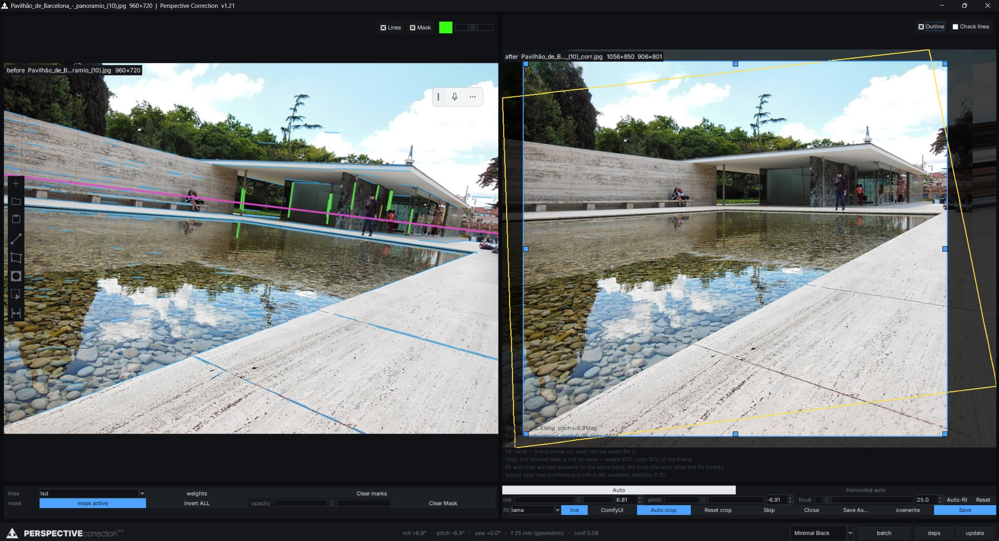
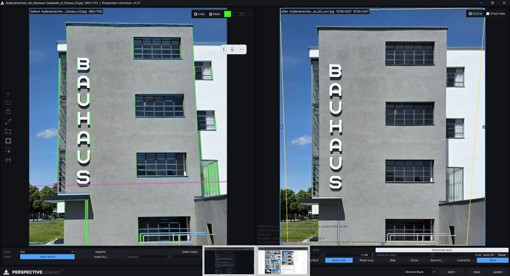
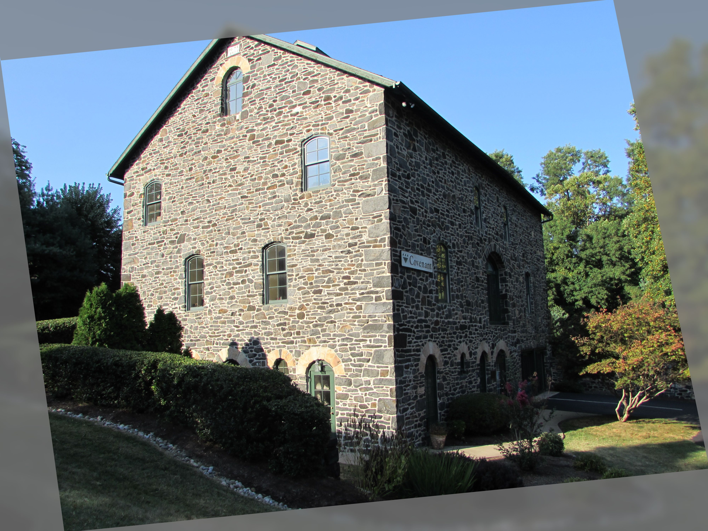

# Perspective Correction



Straightens architectural photographs, one at a time or in a batch. Two modes:

- **Auto**: converging verticals made plumb and the frame levelled — roll,
  pitch and focal length, a camera rotation `H = K R K⁻¹`, so the correction
  cannot shear the picture.
- **Horizontal auto**: an obliquely shot facade turned into a **frontal view**,
  verticals plumb *and* horizontals level, so the wall comes out as a true
  rectangle in its **real proportions**.

You review one photograph at a time and nothing is written until **Save**.

## Horizontal auto: frontal facades from oblique shots



This mode is for **facade textures for 3D**, **Google Street View grabs**,
elevation tracing, or any wall you could only photograph from the side. The
wall comes out in its **real proportions**: squares stay square. Even a wall
seen so steeply that its own horizon crosses the photograph is rectified and
framed around the facade rather than refused. On a corner view only one wall
can come out frontal: drag the **facade strip** onto that wall. A drawn
horizontal line overrules the detector.

## The review window

Two panes — **before** on the left, **after** on the right. The after pane
recomputes live as you move anything, and the status line draws itself faintly
over it. Detected lines are drawn on the before pane, and a click on a line
toggles it out of and back into the fit.

**Sliders, in real time.** Auto mode: roll (−20°…20°), pitch (−30°…30°) and
focal length (8…200 mm, 35 mm equivalent), each with a spinbox. Horizontal
auto adds a yaw slider (−60°…60°) that de-converges the facade, plus a
**detail** slider that trades pixels near the edges for a larger usable
area. **Auto-fit** applies the detector's roll and pitch; **Reset** zeroes
the angles.

**Tools** (click the palette, or press the key):

- **Mark** (`m`): click two points → one line that comes out *exactly*
  vertical or horizontal, by its lean. A click on a line removes it; two lines
  of a direction override the detector, and a vertical pair plus a horizontal
  pair make a rectangle with 90° corners. Hold Alt for a slow, fine loupe.
- **PC Rectangle**: click four corners in any order → one wall flattened to a
  front view in its real proportions, cropped to 20 % around it. Drag a corner
  to adjust the rectangle; right-click clears it.
- **Brush** (`b`): paint pixels out of the line detection. Left drag paints,
  right drag (or Alt + left) erases, and a sideways Shift + left (or
  Alt + right) drag sizes the pen.
- **SAM** (`s`, optional add-on): drag a box; everything outside it is masked
  out of the detection. Right-click clears it.
- **Facade strip**: two rulers on the before pane; a popup shows the strip as
  fractions of the image width. It restricts the detector's evidence to that
  part of the facade — the tool for one wall of a corner view.

A full-resolution **loupe** follows the pointer (it flips at the panel edge
and parks in the gutter between the panes), so points land at pixel
precision. Every control explains itself on hover, after a second.

**Crop.** Auto crop trims the frame while the loss stays small; drag the crop
by hand and the switch turns itself off, and the crop becomes draggable
handles. **Reset crop** brings it back.

**Edge fill, previewed in place.** A combo picks the fill (`none`, `telea`,
`lama`, `comfyui`), a **live** checkbox previews the chosen fill in the after
pane instead of the fast stand-in (about a second per redraw), and a button
opens the ComfyUI settings: server address, **Test connection**, and
selectors for the workflow and the models.

**Actions.** Skip / Close / Save As… / Save (the accent button advances to the
next photograph), an overwrite checkbox, undo and redo, and a held Space key
shows the uncorrected original in the after pane. Drag photographs onto the
window to queue them.

**Themes.** Minimal Black (default), Dark Grey, Phosphor, Amiga 500 and C64,
chosen in the status bar; the icons follow.

## Automatic correction

A line detector finds the facade, and on most photographs that is the whole
job: **lsd** is built in, and **mlsd** (an optional add-on) keeps only
structural edges, which helps where cars, a sloping street or roof battens
fool lsd. The fit solves roll, pitch and focal length together, damps the
pitch when the focal length is only a guess, and refuses warps that would
inflate the frame too much. The option `--horizontal` de-converges the
dominant horizontal vanishing point as well; it is off by default, because a
wrong or weak horizontal vanishing point shears the frame sideways, which
reads as a mistake faster than a slightly under-corrected vertical.

Where the detector is not confident, the photograph is left alone: below a
confidence threshold of 0.4 nothing is written, and images a line detector
cannot place are skipped rather than guessed.

## Edge fill

When a correction keeps the whole frame, the rotation opens a band of
pixels that were never photographed. The pad fills it with an extended border
colour (or a colour of your choice); a **fill** generates it instead. Only
that band is ever touched — the photographed pixels survive bit for bit.

- **telea** — built into OpenCV, zero extra dependencies, instant. It smears
  the edge inwards.
- **lama** — LaMa via `simple-lama-inpainting`, an optional add-on that needs
  torch. About half a second per photo, and it continues the structure
  instead of smearing it. It is the default: if the package is missing, the
  run steps down to telea with a note; an explicit `--fill lama` refuses
  instead.
- **comfyui** — a running ComfyUI over HTTP: a diffusion model that invents
  rather than continues.



The shipped graph (`workflows/flux2-klein-edit-nomask.json`) is written for an
**edit model**: it receives the corrected frame and a text instruction, with no
mask node. Before the request goes out, PC **primes** the band: LaMa fills the
hole (telea on any failure) and blends the result 50 % to mid grey, so the
sampler gets colour and texture without preserving invented structure, and the
instruction simply says to remove the grey border. The sampler's pixels are
pasted into the hole and nowhere else.

An **inpainting model** wants a different graph and no example ships: build
it in ComfyUI, save in API format, and title the nodes `BPC_IMAGE`,
`BPC_MASK` and (optionally) `BPC_PROMPT` — PC routes the photograph, the hole
and the prompt to them. The settings popup checks the model filenames the
graph names against your server, substitutes the closest match, and marks a
guess. Generation runs on a reduced long edge (default 2048 px) and is pasted
back at full resolution; `--fill-max-share` refuses to invent more than a
quarter of the frame by default.

## Batch, unattended

Drop a folder of photographs onto the window — or the `batch` button in the
footer — and PC asks once: *Correct N photograph(s) unattended?* While it
runs the button becomes a stop counter; the results land as `<name>_corr`
beside each input (or in an output folder), and when the run finishes a
summary dialog reports **processed / skipped / errors** and the output
folder. Skipped and error photographs open for review afterwards, and errors
are written to `pc_errors.log`.

EXIF and ICC profiles are carried through: orientation is applied,
non-sRGB profiles are converted on load, and the save is tagged sRGB.
`--no-exif` drops both.

## Keyboard shortcuts

| Key (Windows) | Key (macOS) | Action |
|---|---|---|
| `m` | `m` | **Mark**: two points → one exact vertical or horizontal line; click a line to remove it |
| `b` | `b` | **Brush**: paint out of the detection (left drag paints, right drag erases, sideways drag sizes) |
| `s` | `s` | **SAM**: drag a box, everything outside is masked (optional add-on) |
| — | — | **PC Rectangle** and **facade strip** live in the tool palette; they have no key |
| `F11` | `F11` | toggle fullscreen |
| hold `Space` | hold `Space` | the after pane shows the uncorrected original; release returns to the correction |
| `Ctrl+V` | `Cmd+V` | paste an image or copied files from the clipboard |
| `Ctrl+S` | `Cmd+S` | save (also advances to the next photograph) |
| `Ctrl+N` / `Ctrl+Right` | `Cmd+N` | next photograph (a dirty one is offered for saving first) |
| `Ctrl+Z` | `Ctrl+Z` | undo |
| `Ctrl+Y` / `Ctrl+Shift+Z` | `Ctrl+Y` / `Ctrl+Shift+Z` | redo |
| `Esc` | `Esc` | exit fullscreen (does nothing while windowed) |

Keys that land in a text field stay with the field, and dialogs keep their own
keyboard. On a Mac, Option replaces Alt in the tool gestures and the
right-click gestures use the right button.

## Install

The program wants **Python 3.10+** with Tkinter. The default install is
minimal — about 46 MB of downloads (the program, numpy,
opencv-python-headless, Pillow, piexif and tkinterdnd2) and no torch — and
the installer probes the target Python first, so packages it already has are
skipped (0 MB). Everything optional is installed either at install time
(`--mlsd`, `--lama`, `--full`) or later from inside the program: the **deps**
button at the bottom right lists only what is missing and installs what you
tick (it also fetches the SAM weights and, once, says *drag and drop works
after a restart*). `python perspective_correction.py --doctor` reports what
this interpreter can run.

### Windows

**Double-click `Install (Windows).bat`.** It asks where to install:

1. **System Python** — installs into the Python on PATH and reuses whatever
   is already there.
2. **Local `.venv`** — a self-contained virtual environment next to the code.

(Add `--mlsd`, `--lama` or `--full` to the bat to take the optional parts.)
It then builds `Perspective Correction.exe` with the logo
(`tools/make_launcher.py`, which needs .NET 4; without it the `.bat`
launcher is used).

**Double-click `Perspective Correction.exe`** (or `Perspective
Correction.bat`) to start, and drag photographs onto the window. The
launcher resolves the interpreter in three tiers, first existing one wins:
a `.pc_python` pin (written when you install into an external venv with
`--venv <dir>`), then `.venv` next to the code, then `pythonw` on PATH.

### macOS

**One line in Terminal** — it fetches the code into
`~/Perspective-Correction`, offers to install Python if it is missing, then
installs everything:

```
curl -fsSL https://raw.githubusercontent.com/metamountain/Perspective-Correction/main/tools/install_mac.sh | bash
```

Or **double-click `Install (macOS).command`** from a copy of the code; it
installs into `.venv` beside it, and `Perspective Correction.command` starts
from that `.venv` (it tells you to run the installer first if the `.venv` is
missing).

### Linux, or by hand

```
pip install -r requirements.txt          run it from this folder
pip install -e .                         or install it, and get the `pc` command
pip install --no-deps ai-edge-litert     optional: the mlsd detector
pip install --no-deps simple-lama-inpainting   optional: the lama fill (telea without it)
```

The `--no-deps` matters for lama: its dependency pins otherwise break
OpenCV. `python perspective_correction.py --gui` opens the review window;
`python tools/install_deps.py --help` shows the installer's own options
(`--mlsd`, `--lama`, `--full`, `--venv DIR`, `--system`).

**Sizes** (on Windows, Python 3.12). The program itself is small; almost
everything is the optional AI parts, and most of that is torch:

| part | on disk | needed for |
|---|---|---|
| **the program** | **14 MB** | everything (includes the M-LSD model, fonts and 4 test photos) |
| numpy, OpenCV, Pillow, piexif | 190 MB | everything |
| tkinterdnd2 | 3 MB | drag photographs onto the window |
| ai-edge-litert | 59 MB | the mlsd detector |
| torch | 0.25–0.7 GB (CPU, macOS) · 3.1 GB (Windows CUDA) | lama, SAM |
| lama + its weights | 206 MB | the good fill for the empty corners (telea fills without it) |
| SAM 2.1 small + transformers | 306 MB | box select (`s`) |

With all of it on Windows that is about 4 GB, of which the program is under
0.5 %; without the optional parts it is about 7 %.

The window is made for a **1920×1080** screen or larger; smaller screens (or
display scaling) still fit, down to 1366×768, with smaller pictures.

**Platforms.** Developed and tested on Windows. CI runs the core tests on
Linux and macOS too; the window itself is tested on Windows only. On a Mac
the right-click gestures use the right button and Option replaces Alt, but
nobody has tried them there yet.

**Keeping it current.** The **update** button checks GitHub for a newer
release, shows what changed, and takes it only if you confirm; it works with
a git checkout or a downloaded copy, refuses a dirty tree, and restarts the
program afterwards.

## Command line

```
python perspective_correction.py --gui                          the review window
python perspective_correction.py "D:\Fotos"                     batch: write Foto_corr.jpg beside each
python perspective_correction.py "D:\Fotos" --horizontal        batch, Horizontal auto
python perspective_correction.py --help                         every option
```

On Windows, `Perspective Correction.exe` with the logo starts the window
without a console and opens photographs dropped onto it. The biggest
accuracy win is telling it the lens: `--focal-35mm 24`.

### CLI reference

This is exactly what `python perspective_correction.py --help` prints:

```
usage: perspective_correction [-h] [-o OUTPUT] [--suffix SUFFIX] [--overwrite]
                              [--yes] [-r] [--skip-existing]
                              [--strength STRENGTH]
                              [--pitch-strength PITCH_STRENGTH]
                              [--roll-strength ROLL_STRENGTH]
                              [--max-pitch MAX_PITCH] [--max-roll MAX_ROLL]
                              [--clamp-beyond-limit]
                              [--min-correction MIN_CORRECTION] [--no-roll]
                              [--no-pitch] [--horizontal]
                              [--horizontal-strength HORIZONTAL_STRENGTH]
                              [--max-horizontal MAX_HORIZONTAL]
                              [--strip X0 X1]
                              [--min-confidence MIN_CONFIDENCE]
                              [--max-area MAX_AREA] [--focal-35mm FOCAL_35MM]
                              [--default-focal-35mm DEFAULT_FOCAL_35MM]
                              [--no-exif-focal] [--no-refine]
                              [--focal-estimate {off,vp,horizon,both}]
                              [--uncertain-damping UNCERTAIN_DAMPING]
                              [--detector {lsd,mlsd}]
                              [--mlsd-model MLSD_MODEL] [--detector-info]
                              [--doctor] [--mask {off,file}] [--remember]
                              [--forget] [--diagnostics]
                              [--mask-file MASK_FILE] [--mask-invert]
                              [--detect-max-edge DETECT_MAX_EDGE]
                              [--min-line-length MIN_LINE_LENGTH]
                              [--inlier-threshold INLIER_THRESHOLD]
                              [--angular-softness ANGULAR_SOFTNESS]
                              [--seed SEED] [--merge-lines]
                              [--crop {auto,aspect,inside,none}]
                              [--max-crop-loss MAX_CROP_LOSS]
                              [--pad EDGE|COLOUR]
                              [--fill {none,telea,lama,comfyui}]
                              [--fill-max-edge FILL_MAX_EDGE]
                              [--fill-max-share FILL_MAX_SHARE]
                              [--fill-device FILL_DEVICE]
                              [--comfy-url COMFY_URL]
                              [--comfy-workflow FILE.json]
                              [--comfy-prompt COMFY_PROMPT]
                              [--comfy-seed COMFY_SEED] [--fill-info]
                              [--keep-size] [--jpeg-quality JPEG_QUALITY]
                              [--no-exif]
                              [--interpolation {lanczos,cubic,linear}] [-n]
                              [--debug-dir DEBUG_DIR] [--log-file LOG_FILE]
                              [--json-report JSON_REPORT] [-j WORKERS] [-v]
                              [-q] [--gui]
                              [inputs ...]

Straighten converging verticals in architectural photos, in batch. Images the
detector is not confident about are left alone.

positional arguments:
  inputs                image files and/or folders (default: None)

options:
  -h, --help            show this help message and exit
  -o OUTPUT, --output OUTPUT
                        output folder (default: beside the input) (default:
                        None)
  --suffix SUFFIX       suffix for output files (default: _corr)
  --overwrite           replace the originals (default: False)
  --yes, -y             do not ask before overwriting (default: False)
  -r, --recursive       descend into subfolders (default: False)
  --skip-existing       do not redo existing outputs (default: False)
  --gui                 open the graphical batch window (default: False)

correction:
  --strength STRENGTH   scale both corrections (0 = none, 1 = full) (default:
                        1.0)
  --pitch-strength PITCH_STRENGTH
                        scale the converging-verticals fix (default: None)
  --roll-strength ROLL_STRENGTH
                        scale the levelling (default: None)
  --max-pitch MAX_PITCH
                        cap on the converging-verticals fix, degrees (default:
                        30.0)
  --max-roll MAX_ROLL   cap on levelling, degrees (default: 12.0)
  --clamp-beyond-limit  apply the capped correction when the estimate runs
                        past --max-pitch/--max-roll, instead of refusing the
                        photo. The default is to refuse: an estimate that
                        extreme is usually about something that is not a
                        facade (default: False)
  --min-correction MIN_CORRECTION
                        below this the photo counts as already upright,
                        degrees (default: 0.15)
  --no-roll             never level, only fix verticals (default: False)
  --no-pitch            only level, never fix verticals (default: False)
  --horizontal          also de-converge the dominant horizontal vanishing
                        point (yaw). Off by default: a wrong or weak
                        horizontal VP shears the frame sideways, which reads
                        as a mistake faster than a slightly under-corrected
                        vertical (default: False)
  --horizontal-strength HORIZONTAL_STRENGTH
                        scale the horizontal (yaw) correction (0 = none, 1 =
                        full) (default: None)
  --max-horizontal MAX_HORIZONTAL
                        cap on the horizontal (yaw) correction, degrees
                        (default: 60.0)
  --strip X0 X1         restrict the evidence to the vertical strip X0..X1,
                        given as FRACTIONS of the image width (0..1) -- e.g.
                        0.02 0.46 for the left facade of a corner view. Both
                        pools are restricted, verticals included: the two
                        faces of a corner have different vertical clusters. A
                        strip holding no lines of a kind leaves that pool
                        whole (default: None)

decision:
  --min-confidence MIN_CONFIDENCE
                        below this the image is left unchanged (default: 0.4)
  --max-area MAX_AREA   refuse warps that inflate the frame more than this
                        (default: 9.0)

camera:
  --focal-35mm FOCAL_35MM
                        override the focal length, 35mm equivalent (default:
                        0.0)
  --default-focal-35mm DEFAULT_FOCAL_35MM
                        assumed focal length when EXIF has none (default:
                        28.0)
  --no-exif-focal       ignore the EXIF focal length (default: False)
  --no-refine           skip the joint (roll,pitch,f) fit (default: False)
  --focal-estimate {off,vp,horizon,both}
                        estimate the focal length from the geometry as well as
                        the prior (default: vp)
  --uncertain-damping UNCERTAIN_DAMPING
                        scale the pitch fix when the focal length is only a
                        guess (default: 1.0)

detection:
  --detector {lsd,mlsd}
                        line detector; mlsd needs a TFLite runtime (pip
                        install --no-deps ai-edge-litert) (default: lsd)
  --mlsd-model MLSD_MODEL
                        M-LSD tflite model path, or a filename inside models/
                        (default: )
  --detector-info       what this Python can run as a line detector, and exit
                        (default: False)
  --doctor, --check-deps
                        report the core packages and every optional backend
                        this interpreter can run, and exit. Exits 2 if a
                        required package is missing (default: False)
  --mask {off,file}     'file' a painted PNG or a folder of them (see --mask-
                        file) (default: off)
  --remember            store --mask-file, -o, --focal-35mm, --pad, --comfy-
                        url and --comfy-workflow as defaults for future runs
                        (default: False)
  --forget              delete the remembered defaults and exit (default:
                        False)
  --diagnostics         print the environment (interpreter, versions,
                        backends, settings) before the run, so a log is self-
                        describing (default: False)
  --mask-file MASK_FILE
                        a PNG mask, or a folder holding one <stem>.png per
                        image (default: )
  --mask-invert         the mask marks what to KEEP, which is what a segmenter
                        naturally outputs (default: False)
  --detect-max-edge DETECT_MAX_EDGE
  --min-line-length MIN_LINE_LENGTH
                        minimum line length as a fraction of the short edge
                        (default: 0.035)
  --inlier-threshold INLIER_THRESHOLD
                        RANSAC inlier band, degrees (default: 1.6)
  --angular-softness ANGULAR_SOFTNESS
                        how sharply leaning lines are down-weighted; lower is
                        stricter, which helps on half-timbered facades
                        (default: 0.35)
  --seed SEED
  --merge-lines         join collinear fragments before fitting (measurably
                        worse; kept for images whose edges are heavily broken
                        up) (default: False)

output:
  --crop {auto,aspect,inside,none}
                        'auto' crops while the loss stays under --max-crop-
                        loss and keeps the whole frame otherwise;
                        'aspect'/'inside' always crop; 'none' never does
                        (default: auto)
  --max-crop-loss MAX_CROP_LOSS
                        with --crop auto, the share of the frame a crop may
                        cost before the whole frame is kept and padded instead
                        (default: 0.05)
  --pad EDGE|COLOUR     what fills the corners a rotation opens up when the
                        frame is kept: 'edge' extends the border colour, or
                        give a colour as a name (black, white, grey), #rrggbb,
                        or r,g,b (default: edge)
  --fill {none,telea,lama,comfyui}
                        generate the padded band instead of leaving it padded.
                        'lama' is the default and needs simple-lama-
                        inpainting; 'telea' needs nothing but smears the edge
                        inwards and costs MORE at full size; 'comfyui' needs a
                        running ComfyUI. '--fill none' keeps the pad. Only the
                        padded band is ever touched -- these pixels were never
                        photographed. Each -j worker loads its own copy of the
                        model (default: lama)
  --fill-max-edge FILL_MAX_EDGE
                        generate at this long edge and paste back at full
                        resolution; 0 generates at full size (default: 2048)
  --fill-max-share FILL_MAX_SHARE
                        refuse to invent more than this fraction of the frame
                        (default: 0.4)
  --fill-device FILL_DEVICE
                        torch device for the local fill; empty picks its
                        default (default: )
  --comfy-url COMFY_URL
  --comfy-workflow FILE.json
                        ComfyUI API-format workflow; empty takes the bundled
                        workflows/flux2-klein-edit-nomask.json, which is
                        written for an edit model (image + instruction). An
                        inpainting model wants a different graph and no
                        example ships -- build it in ComfyUI, Save (API
                        format), and title the nodes. BPC_IMAGE, BPC_MASK and
                        (optionally) BPC_PROMPT are where the photograph, the
                        hole and the prompt go; --fill-info names whichever
                        graph is actually in force (default: )
  --comfy-prompt COMFY_PROMPT
                        text for the node titled BPC_PROMPT (default: )
  --comfy-seed COMFY_SEED
                        force every sampler seed in the workflow; 0 leaves
                        them (default: 0)
  --fill-info           whether the chosen fill backend is usable, and exit
                        (default: False)
  --keep-size           rescale the crop back to the original pixel dimensions
                        (default: False)
  --jpeg-quality JPEG_QUALITY
  --no-exif             do not carry EXIF/ICC over (default: False)
  --interpolation {lanczos,cubic,linear}

reporting:
  -n, --dry-run         decide but write nothing (default: False)
  --debug-dir DEBUG_DIR
                        write line/horizon overlays and before-after pairs
                        here (default: None)
  --log-file LOG_FILE   append the log to this file as well (default: None)
  --json-report JSON_REPORT
                        write a machine readable report here (default: None)
  -j WORKERS, --workers WORKERS
                        parallel workers (0 = one per core, 1 = sequential)
                        (default: 0)
  -v, --verbose
  -q, --quiet
```

More to read: [accuracy](docs/accuracy.md) · [algorithm](docs/algorithm.md) ·
[detectors](docs/detectors.md) · [masking](docs/masking.md).

## Credits and licence

MIT. See LICENSE and CREDITS. Descended from
[chsasank/Image-Rectification](https://github.com/chsasank/Image-Rectification)
([review](docs/reference-review.md)); design informed by darktable's `ashift`
and ShiftN ([prior art](docs/prior-art.md)), no code taken from either. README
photographs from Wikimedia Commons, credited beneath each; the test pool is
listed in [tests/assets/README.md](tests/assets/README.md).
