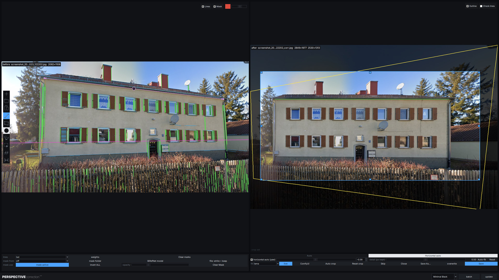
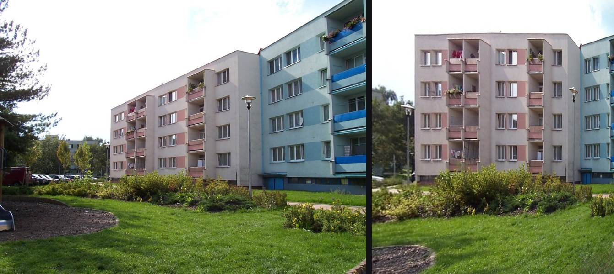
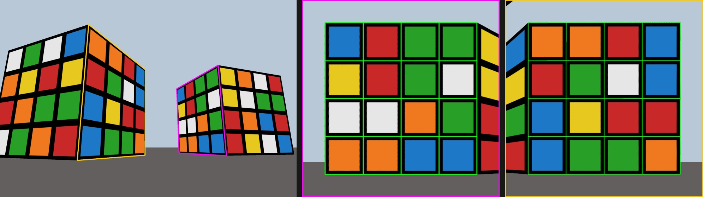

# Perspective Correction



Straightens architectural photographs. Two modes:

- **Auto**: converging verticals made plumb and the frame levelled: roll, pitch
  and focal length, a camera rotation `H = K R K⁻¹`, so it cannot shear.
- **Horizontal auto**: an obliquely shot facade turned into a **frontal view**,
  with verticals plumb *and* horizontals level, so the wall is a true rectangle.

You review one photograph at a time and nothing is written until **Save**.

## Horizontal auto: frontal facades from oblique shots



<sup>Mariánské Hory, panelové domy — [Wikimedia Commons](https://commons.wikimedia.org/wiki/File:Mari%C3%A1nsk%C3%A9_Hory,_panelov%C3%A9_domy_4.jpg), Lukáš Mižoch, CC BY-SA 2.5. Yaw 59.6°, facade strip on the pink wall, lama fill.</sup>

This mode is for **facade textures for 3D**, **Google Street View grabs**,
elevation tracing, or any wall you could only photograph from the side. The wall
comes out in its **real proportions**: squares stay square. Even a wall seen so
steeply that its own horizon crosses the photograph is rectified and framed
around the facade rather than refused. On a corner view only one wall can come
out frontal: drag the **facade strip** onto that wall. A drawn horizontal line
overrules the detector.



<sup>Tested on rendered scenes with known geometry (`tools/render_cubes.py`): 20 m
cubes from 1.6 m eye height. Cell width/height after the correction: 1.000 for
the steep magenta face (its whole-frame warp folds), 1.002 for the yellow one.</sup>

## Detectors first, a few seconds of your hand second

A line detector (**lsd**, or **mlsd**, which keeps only structural edges) finds
the facade, and on most photographs that is the whole job. Where it is fooled by
cars, a sloping street, roof battens or a second wall, a few seconds of hand work
on the picture fix it:

- **paint it out** (`b`), **box it in** with SAM (`s`), or name it (Grounding DINO);
- **draw the truth** (`m`): a drawn line comes out *exactly* vertical or
  horizontal, and 2 + 2 drawn lines make a rectangle with 90° corners;
- **click four corners** (PC Rectangle): one wall flattened to a front view in
  its real proportions (squares come out square), cropped to 20 % around it,
  with more of the picture kept to drag the crop out by hand.

A loupe follows the pointer while you place points. Every control explains
itself on hover (after a second).

## Install

**Double-click** `Install (Windows).bat` or `Install (macOS).command`
(`--lama` adds the lama fill, which needs torch). Windows installs into the
Python on PATH; macOS into `.venv` here, and `Perspective Correction.command`
starts from it. On Linux, or by hand:

```
pip install -r requirements.txt        run it from this folder
pip install -e .                       or install it, and get the `pc` command
pip install --no-deps ai-edge-litert   optional: the mlsd detector
pip install --no-deps simple-lama-inpainting   optional: lama fill (default; telea without it)
```

Python 3.9+, numpy, OpenCV, Pillow, piexif. The GUI needs Tkinter.
`--no-deps` matters: lama's pins otherwise break OpenCV.
`python perspective_correction.py --doctor` says what is present. Segmentation weights
(BiRefNet, Grounding DINO, SAM 2) are not in the repo; see [docs/masking.md](docs/masking.md).

Screen: made for **1920×1080** or larger. Smaller screens (or display scaling)
still fit, down to 1366×768, with smaller pictures.

**Developed and tested on Windows.** CI runs the core tests on Linux and macOS
too; the window itself is tested on Windows only. On a Mac the right-click
gestures use the right button and Option replaces Alt, but nobody has tried
them there yet.

## Use

```
python perspective_correction.py --gui                          the review window
python perspective_correction.py "D:\Fotos"                     batch: write Foto_corr.jpg beside each
python perspective_correction.py "D:\Fotos" --horizontal        batch, Horizontal auto
python perspective_correction.py --help                         every option
```

or, on Windows, run `python tools/make_launcher.py` once: it builds
`Perspective Correction.exe` with the logo, which starts the window without a
console and opens photographs dropped onto it (`Perspective Correction.bat`
still works). The biggest accuracy win is
telling it the lens: `--focal-35mm 24`.

More: [accuracy](docs/accuracy.md) · [algorithm](docs/algorithm.md) ·
[detectors](docs/detectors.md) · [masking](docs/masking.md).

## Credits and licence

MIT. See LICENSE and CREDITS. Descended from
[chsasank/Image-Rectification](https://github.com/chsasank/Image-Rectification)
([review](docs/reference-review.md)); design informed by darktable's `ashift`
and ShiftN ([prior art](docs/prior-art.md)), no code taken from either. README
photographs from Wikimedia Commons, credited beneath each; the test pool is
listed in [tests/assets/README.md](tests/assets/README.md).
